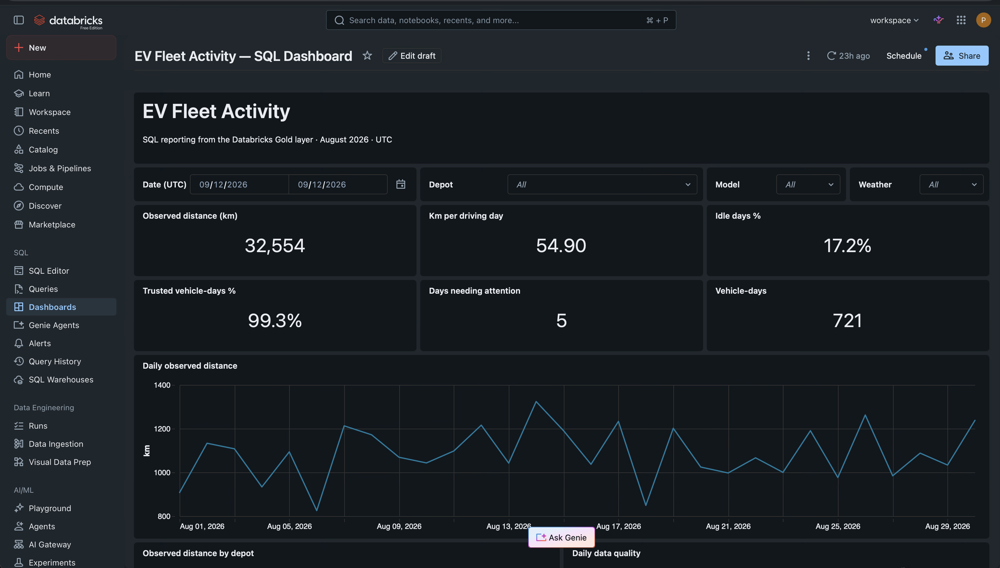
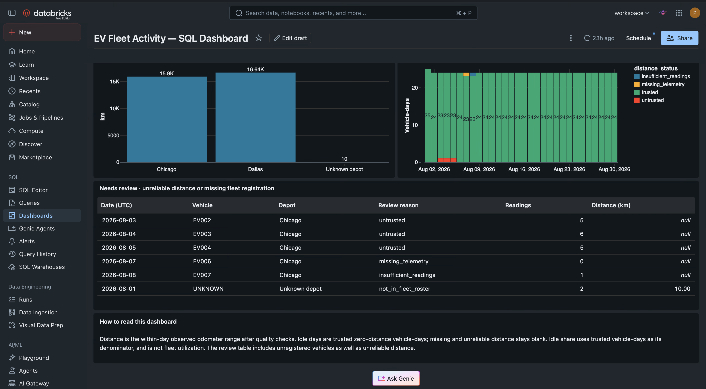
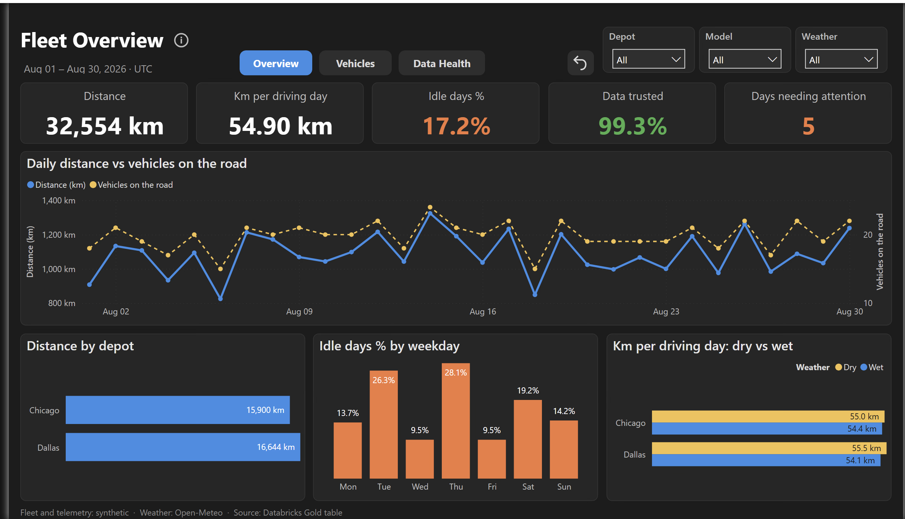
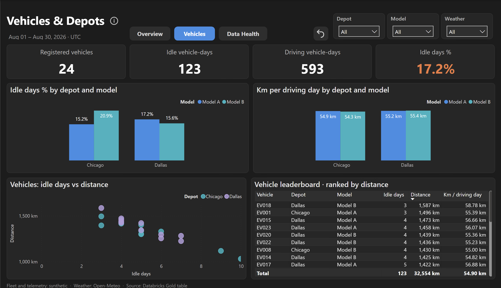
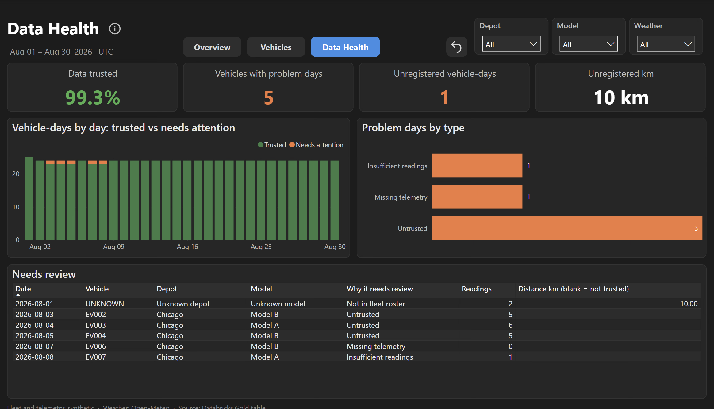
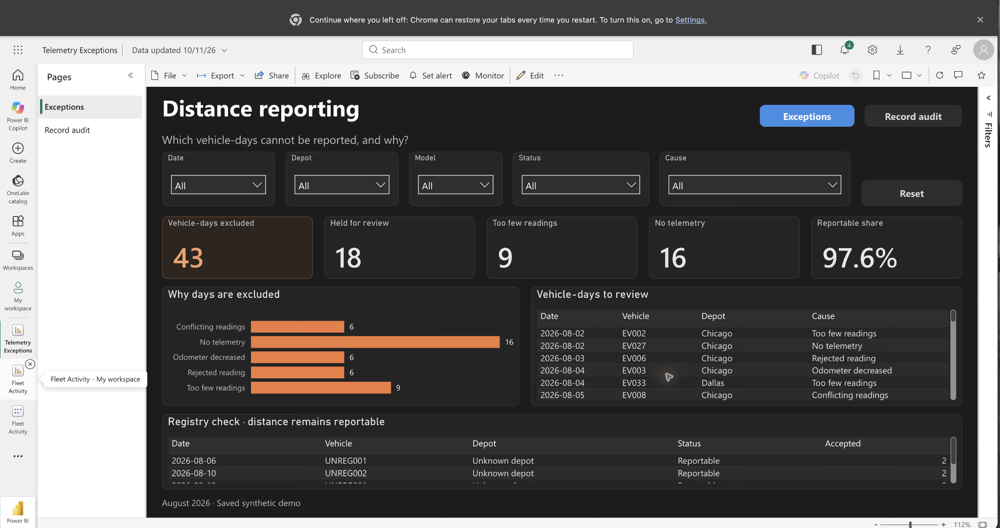
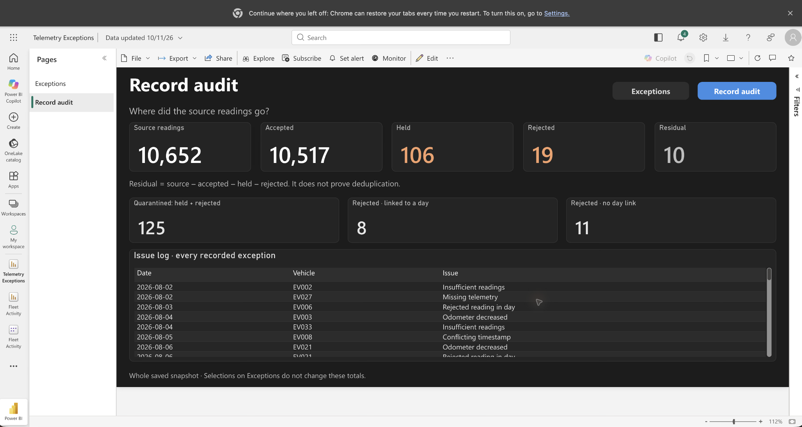

# EV Fleet Activity — Databricks Lakehouse

A **Databricks lakehouse pipeline built with PySpark, SQL, and Delta Lake**, combining telemetry files, a fleet SQL database, and a real weather API through Bronze → Silver → Gold. A daily Databricks job runs the pipeline, and Gold feeds three dashboards: a **native Databricks SQL dashboard**, **Fleet Activity in Power BI**, and **Telemetry Exceptions in Power BI**.

**[Open Fleet Activity in Power BI](https://app.powerbi.com/view?r=eyJrIjoiMzUzYmU0YWEtYzU4NC00NmE1LTk2NmYtZjI4YTViMDhjMjY1IiwidCI6IjhiYmMwZjRiLTVkNWItNGNiMy05ZWM5LTc1MTc0MjRmMzY0ZiJ9&pageName=overview)** — public access, no sign-in required.

**[Open Telemetry Exceptions in Power BI](https://app.powerbi.com/view?r=eyJrIjoiMWUzN2I0YjktYjBlZS00Y2E0LWI3OGYtOGNlYmIyYmRmYzkyIiwidCI6IjhiYmMwZjRiLTVkNWItNGNiMy05ZWM5LTc1MTc0MjRmMzY0ZiJ9)** — public access, no sign-in required.

**Business question:** how does observed vehicle movement vary by depot, vehicle model, and weather condition—and where is the data too incomplete or inconsistent to report a distance?

```text
Synthetic JSONL telemetry ──→ Bronze ──→ checked readings / quarantine ──┐
Synthetic fleet SQLite DB ──→ SQL extraction ──→ vehicle and depot ─────┼─→ Gold vehicle/day fact ─→ Power BI + Databricks dashboards
Open-Meteo historical API ──→ saved JSON ──→ daily weather ─────────────┘
```

[Databricks setup and notebooks](fleet_activity/databricks/README.md) · [Run locally](fleet_activity/README.md) · [Bronze](fleet_activity/notebooks/01_bronze_ingestion.ipynb) · [Silver](fleet_activity/notebooks/02_silver_cleaning.ipynb) · [Gold](fleet_activity/notebooks/03_gold_activity.ipynb) · [Validation and reviews](fleet_activity/evidence/README.md)

## Three dashboards from the Gold layer

| Reporting experience | What it provides | Access and source |
| --- | --- | --- |
| **Native Databricks SQL dashboard** | Fleet KPIs, daily distance, depot comparisons, quality coverage, filters, and a review table. Published and checked against the original baseline; expanded query/UI checks remain separate. | Requires Databricks sign-in and data permissions. [Dashboard documentation](fleet_activity/databricks/dashboard/README.md) · [SQL dataset](fleet_activity/databricks/dashboard/activity.sql) |
| **Fleet Activity — Power BI** | Three interactive pages: Overview, Vehicles & Depots, and Data Health, with a star schema and DAX measures. Imports Databricks Gold. | Public report link above; no sign-in required. [Model and setup](fleet_activity/power_bi/README.md) |
| **Telemetry Exceptions — Power BI** | Exceptions and Record audit pages explain reporting exclusions and reconcile accepted, held and rejected readings. | [Open the public report](https://app.powerbi.com/view?r=eyJrIjoiMWUzN2I0YjktYjBlZS00Y2E0LWI3OGYtOGNlYmIyYmRmYzkyIiwidCI6IjhiYmMwZjRiLTVkNWItNGNiMy05ZWM5LTc1MTc0MjRmMzY0ZiJ9), no sign-in required · [Editable source and setup](fleet_activity/power_bi/telemetry_exceptions/README.md) |

## Native Databricks dashboard preview

Fleet KPIs and daily distance, built in Databricks over the Gold table. The interactive dashboard requires authorized workspace access; these screenshots let visitors preview it directly.



<details>
<summary>Depot comparisons, daily data quality, and records needing review</summary>



</details>

User-supplied screenshots from 12 September 2026. The visible date control differs from the August data shown; see [capture notes](docs/screenshots/README.md#databricks-date-control).

## Fleet Activity — Power BI preview (September baseline)

**Overview:** observed distance, driving activity, idle days, and data coverage across the reporting period.



<details>
<summary>Vehicles &amp; Depots — compare usage and inspect individual vehicles</summary>



</details>

<details>
<summary>Data Health — inspect missing, inconsistent, and unregistered records</summary>



</details>

Power BI screenshots from 12 September 2026 with all filters set to All; all three pages use the supplied full-resolution PNG originals. These are static previews; use the report link above to explore. [Screenshot provenance](docs/screenshots/README.md).

## Telemetry Exceptions — Power BI preview

**Exceptions:** which vehicle-days cannot be reported, and why. The expanded data shows 43 excluded days and 97.6% reportable coverage.



<details>
<summary>Record audit — reconcile all 10,652 source readings</summary>



</details>

Owner-supplied Power BI Service screenshots from 11 October 2026, showing expanded Gold. All Exceptions slicers are set to All. The original screenshots are preserved byte-for-byte, including the surrounding Service controls; table scrollbars are expected. [Screenshot provenance](docs/screenshots/README.md).

## What it demonstrates

- Databricks notebooks, Unity Catalog managed tables, and a native SQL dashboard over Gold.
- Explicit-schema JSON ingestion and real Delta table writes.
- SQL extraction from a local SQLite database, with a declared static roster.
- A real REST API request, bounded retries, response checks and saved inputs for reproducible reruns.
- SQL window functions in Spark, deduplication, quarantine, and consistent joins across three sources.
- A vehicle/date grid that reveals missing telemetry and retains unknown vehicles.
- Tests that exercise the notebook's actual transformation cells.
- Daily Databricks orchestration with successful upstream dependencies and a verified scheduled full-refresh run; see [job review](fleet_activity/databricks/JOB_REVIEW.md).
- Gold data with coverage status and documented measurement limits, ready for a separate reporting layer.

The source systems are intentionally different. AI assisted with writing the generator that produces the synthetic telemetry files and SQLite fleet database; weather is real historical reanalysis from [Open-Meteo](https://open-meteo.com/en/docs/historical-weather-api). SQLite is a local database, **not a remote JDBC integration**. No claim is made about real fleet behavior or weather causation.

## Measurement

`observed_distance_km` is the odometer range between observed readings **within a UTC day**, reported only when at least two readings pass the checks and the day has no known data issues. It excludes travel outside those observations, including overnight gaps. Missing or questionable data produces a null distance, not zero.

A three-page Power BI report is published with a public report link and now imports directly from Databricks Gold. A Power BI Service on-demand refresh completed on 12 September; daily refresh is configured for 09:00 Central after the 08:00 pipeline. The 13 September scheduled Power BI refresh completed successfully, and the saved Windows model has been synchronized into this repository with connection placeholders. See the [refresh checkpoint](fleet_activity/power_bi/REFRESH_SETUP.md). A [native Databricks SQL dashboard](fleet_activity/databricks/dashboard/README.md) is published and verified against live Gold. See the [Gold-to-Power-BI handoff](fleet_activity/POWER_BI.md).

## Scope and status

The current showcase is entirely in `fleet_activity/`. It is implemented with direct notebook transformations and a small API helper. Local execution, Databricks replay and independent review results are recorded in the linked evidence page. The cloud replay uses saved real API responses; the cloud live request was rate-limited.

This project demonstrates correctness and integration; it is not a scale benchmark or production deployment.

This is a curated repository with a fresh Git history. It contains the runnable fleet project and its required evidence, without the earlier development repository's unrelated prototypes or private review conversations.

The editable Power BI project uses Databricks Import with connection parameters. A clone needs its own SQL warehouse and OAuth sign-in; the local pipeline and tests run without cloud credentials. See [Power BI setup](fleet_activity/power_bi/README.md).

## Expanded August demo and telemetry exceptions

The optional `expanded_august_v1` scenario uses 60 registered vehicles across Chicago and Dallas, three model activity profiles and the same 1–30 August 2026 UTC period. It includes partial coverage, missing days, invalid readings, conflicts and unregistered vehicles. The original 24-vehicle scenario remains the local generator default, preserving the September baseline evidence.

The four-stage Databricks manual replay completed on 11 October 2026: 1,805 activity/quality days, 52 issue occurrences and one whole-snapshot reconciliation row. Quality reporting explains 43 days excluded from distance reporting, while four additional reportable days carry only a registry exception. Reconciliation cards cover the whole snapshot; they do not respond to vehicle-day filters.

Expanded Gold yields 74,441.96 observed km, 63.52 km per driving day, 33.5% idle days and 97.6% trusted coverage. These are calculated Gold expectations. Power BI Service verification on 11 October confirmed Fleet Activity's completed refresh, 97.6% trusted coverage, 18 untrusted, 9 insufficient and 16 missing days, with Model C present. Owner-supplied Exceptions and Record audit screenshots confirmed the expanded card values and clean headers with all slicers set to All. Slicer interactions and Reset remain unverified; no Desktop refresh, synchronization or republish was performed. The September screenshots above remain historical baseline previews. The separate Telemetry Exceptions report provides an Exceptions page and Record audit page; its [reviewed PBIP/TMDL source](fleet_activity/power_bi/telemetry_exceptions/README.md) is included as a companion artifact. See [expanded web verification](fleet_activity/power_bi/validation_expanded_august_v1.json) for the exact observed scope.

Weather remains saved real Open-Meteo data. Synthetic activity is independent of weather; differences between weather groups do not establish weather effects.

The existing [Fleet Activity public link](https://app.powerbi.com/view?r=eyJrIjoiMzUzYmU0YWEtYzU4NC00NmE1LTk2NmYtZjI4YTViMDhjMjY1IiwidCI6IjhiYmMwZjRiLTVkNWItNGNiMy05ZWM5LTc1MTc0MjRmMzY0ZiJ9&pageName=overview) was verified in a fresh Incognito window on 11 October with no sign-in. It displayed 74,442 km, 63.52 km per driving day, 33.5% idle, 97.6% trusted and 43 days needing attention with filters set to All. This browser check did not produce a local screenshot file.

The [Telemetry Exceptions public link](https://app.powerbi.com/view?r=eyJrIjoiMWUzN2I0YjktYjBlZS00Y2E0LWI3OGYtOGNlYmIyYmRmYzkyIiwidCI6IjhiYmMwZjRiLTVkNWItNGNiMy05ZWM5LTc1MTc0MjRmMzY0ZiJ9) was also verified in a fresh Incognito window on 11 October without sign-in. Both pages displayed the expanded values: 43 excluded days and 97.6% reportable coverage, plus the 10,652-record snapshot reconciliation. This verifies anonymous access and displayed values; Reset and slicer interactions were not tested.
